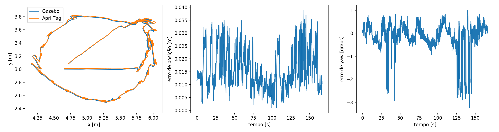
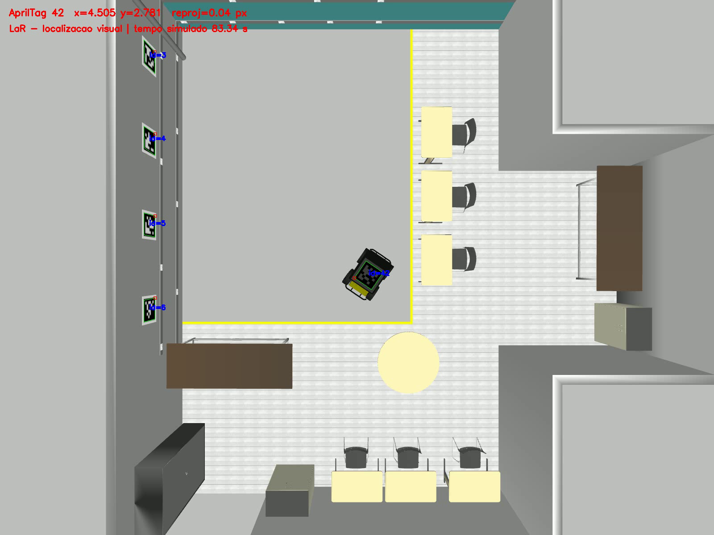

# Resultados da execução no Gazebo

Experimento executado no LaR, ROS Noetic/Gazebo Classic 11, com renderização
por software, câmera 1600×1200 a 15 Hz e tag 36h11 ID 42 sobre o Husky.
A trajetória foi controlada exclusivamente pela pose visual. O sinal
`/top_view/done` confirmou a conclusão dos quatro waypoints.

Foram comparadas **2.521 poses** entre os tempos simulados **0,09 s e 166,61 s**,
abrangendo **166,52 s**. Não houve intervalo entre pares maior que 0,10 s.

| Métrica | Posição planar | Orientação yaw |
|---|---:|---:|
| RMSE | 1,776 cm | 0,720° |
| Erro absoluto médio | 1,601 cm | 0,433° |
| Percentil 95 absoluto | 2,953 cm | 2,238° |
| Máximo absoluto | 3,901 cm | 3,242° |

As trajetórias estimada e verdadeira se sobrepõem, com erro de posição inferior
a 4 cm nesta execução. A orientação apresenta picos de cerca de 3,24°, associados
a variações dos cantos detectados e às condições de movimento. O percurso real
apresenta arcos e correções devido à dinâmica skid-steer do Husky e ao controlador
proporcional simples; o objetivo do controlador é percorrer a área e chegar aos
waypoints, sem impor que a trajetória seja um retângulo perfeito.

O ground truth foi usado somente pelo avaliador, sem realinhamento, correção,
fusão, calibração pela trajetória ou acesso pelo controlador. A altura da tag e a
extrínseca da câmera são valores fixos da montagem descritos no README.

[Vídeo demonstrativo](demo.mp4), com **2.499 quadros, 15 fps e 166,6 s**.
O arquivo foi convertido para H.264, mantendo duração e quantidade de quadros.
A gravação usa imagens reais renderizadas pelo Gazebo com a detecção sobreposta.
O CSV e o vídeo têm assinaturas de tempo independentes; o gravador pode descartar
quadros sob carga. Não são trajetórias sintéticas produzidas para o relatório.

Dados completos: [poses.csv](poses.csv), [metrics.json](metrics.json) e
[run.json](run.json). O campo `observed_done_at_sim_time_s` indica quando o monitor
consultou o sinal latched de conclusão, não o instante exato de chegada; a janela
avaliada é explicitada pelos timestamps inicial e final do CSV.

Validação: compilação Catkin concluída; cinco testes de geometria, identidade da tag e encerramento do gravador
aprovados; quatro verificações de launch aprovadas. O teste de launch emitiu aviso
sobre cache rosdep vazio no contêiner existente, sem falhas nos testes.

Limites: uma única execução em simulação, calibração ideal, pose planar e ausência
de oclusão importante. Os números não representam validação estatística em várias
execuções nem desempenho em um laboratório físico. As métricas incluem somente
poses detectadas e corretamente pareadas no tempo.
